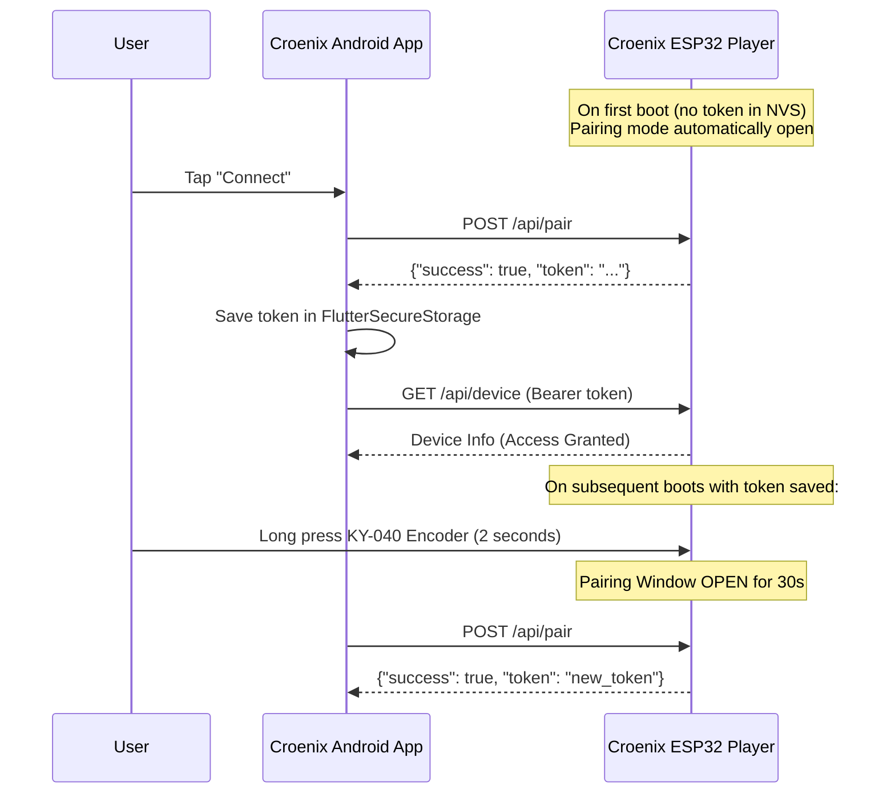

# Croenix Security & Authentication Architecture

## 1. Token Model

- **Format**: 32-character cryptographically pseudorandom alphanumeric string.
- **RNG Source**: Hardware true random number generator (`esp_random()`).
- **Persistence**: Committed to non-volatile flash storage using ESP32 `Preferences` in the `croenix` namespace.
- **Client Storage**: Persisted in Android Keystore / `FlutterSecureStorage` by the Croenix Flutter application.

---

## 2. Pairing Workflow

---

## 3. Brute-Force Rate Limiting

- **Threshold**: 10 consecutive invalid authorization attempts.
- **Lockout Duration**: 60 seconds (`AUTH_LOCKOUT_DURATION_MS`).
- **Timing Protection**: Token comparison uses constant-time XOR byte iteration to prevent side-channel timing analysis.

