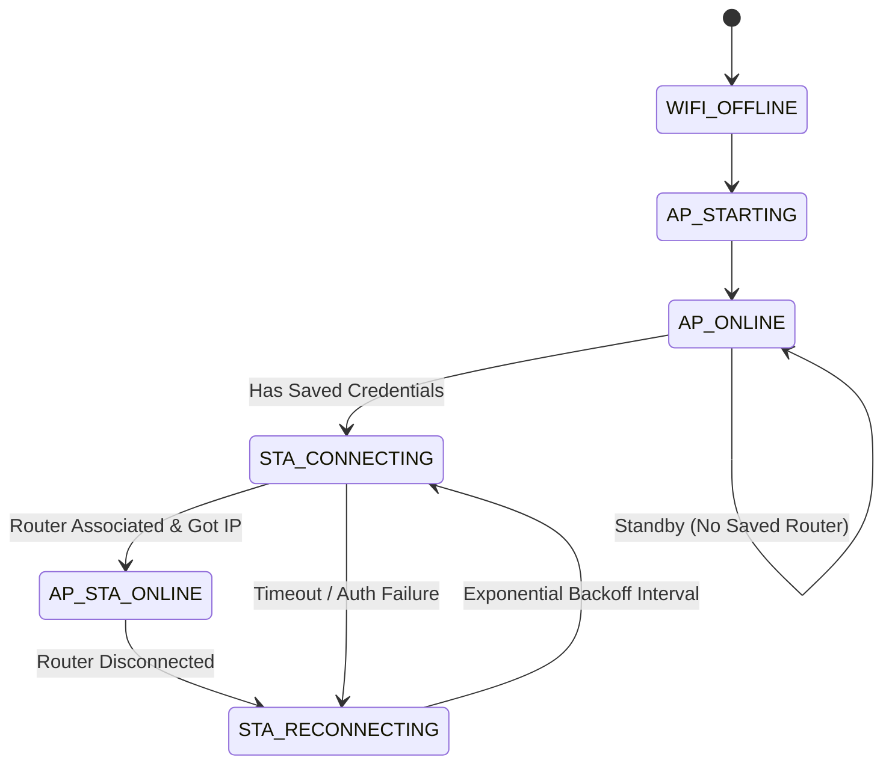

# Croenix Network Connection Architecture

## 1. Simultaneous AP + STA Dual Mode

The ESP32 radio operates in dual AP + STA mode (`WiFi.mode(WIFI_AP_STA)`):
- **Access Point (AP)**: Creates the local private network `Croenix-Audio` at `192.168.4.1`.
- **Station (STA)**: Connects to the user's home 2.4 GHz Wi-Fi router.

### Radio Constraints & Channel Tracking
Because the ESP32 has a single 2.4 GHz RF synthesizer, the Access Point operates on the same Wi-Fi channel as the Station interface when connected to a router. `CroenixWiFiManager` handles channel transitions without tearing down the AP network interface.

---

## 2. Guaranteed Always-On Hotspot

The hotspot is guaranteed to remain operational:
1. Starts unconditionally on boot before router association is attempted.
2. An active watchdog in `CroenixWiFiManager::update()` checks AP health every 5 seconds; if the AP is ever dropped, it is immediately restarted.
3. Phone clients connected to `Croenix-Audio` can communicate directly with the ESP32 even when:
   - No router is configured.
   - The router is out of range or powered off.
   - Router credentials are wrong or changed.

---

## 3. Automatic Recovery State Machine

- **Base Retry Interval**: 5,000 ms.
- **Maximum Retry Interval**: 60,000 ms.
- **Jitter**: ±20% randomized jitter prevents synchronization bottlenecks.

